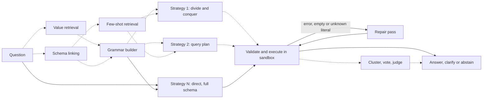

# text2sql-cfg

[](https://github.com/luaygz/text2sql-cfg/actions/workflows/lint.yml)
[](https://github.com/luaygz/text2sql-cfg/actions/workflows/typecheck.yml)
[](https://github.com/luaygz/text2sql-cfg/actions/workflows/tests.yml)
[](https://github.com/luaygz/text2sql-cfg/actions/workflows/grammar-coverage.yml)
[](https://github.com/luaygz/text2sql-cfg/actions/workflows/safety.yml)
[](https://github.com/luaygz/text2sql-cfg/actions/workflows/smoke-eval.yml)
[](https://github.com/luaygz/text2sql-cfg/actions/workflows/docker.yml)
[](https://github.com/luaygz/text2sql-cfg/actions/workflows/audit.yml)

A text-to-SQL system on the OpenAI Responses API in which the model can only write SQL through a custom tool constrained by a Lark grammar built from the database schema. A query the grammar does not describe (a write, a second statement, a comment, a column that does not exist, a function outside the allowlist) cannot be sampled at all. Three more layers assume the grammar failed anyway: an AST validator, a read-only sandboxed executor, and tenant scoping injected by the server. The model never sees a tenant id and has no way to write one.

On BIRD Mini-Dev it reaches 68.0% execution accuracy on a held-out split of 150 questions with the original labels, and 85.2% on the same questions with the corrected Arcwise-Plat-SQL labels, at about $0.0014 per question. The adversarial suite (225 SQL-level attacks plus 50 natural-language attacks on a multi-tenant database) had no violation reach the database.


The BIRD question in the recording runs the five-strategy ensemble (`--set n_candidates=5` with the linked-schema and gpt-6-luna strategies) so that candidates and the vote are visible; the shipped `best` preset is a single candidate (see Results). The recording replays from the committed response cache (`make demo-gif`, no API key needed). There is also a small web page that streams the pipeline trace (`make demo`, localhost only).

## Results

Every number here comes from a report under `reports/` and is reproduced by `make eval-offline` from the committed response cache, with no API key. [RESULTS.md](RESULTS.md) is generated from the same reports and has links to each run; [EXPERIMENTS.md](EXPERIMENTS.md) has the 14 rounds that led to the configuration below.

Configuration (`best` preset): one candidate from gpt-6.1-sol at medium reasoning effort, full schema in the prompt, grammar on, up to two repair turns. The 350-question dev split was used for all tuning; the 150-question test split and the 90-question SaaS test split were each run once, at the end.

### How to audit a number

Each row in [RESULTS.md](RESULTS.md) links to a report directory such as `reports/20261016-211125-70b12ce/`; the name is the run's start time and the git SHA of the code that produced it. Inside are `results.json` (configuration, overrides, spend, summary metrics), `per_question.jsonl` (every question's candidates, SQL, errors, scores, cost and latency), `summary.md` and `failures.md`. The iteration rounds (R0-R13) live under `reports/experiments/` and are cited by directory in EXPERIMENTS.md. To check a number:

1. `make data catalog index` (BIRD download, then catalogs and indexes rebuilt from the cache).
2. `make eval-offline` replays every report under `reports/` (the runs RESULTS.md is built from) with its stored configuration, from the committed response cache and with no API key, and fails on any per-question or summary mismatch, or if RESULTS.md is out of date. `uv run text2sql reproduce reports/<dir>` replays one report. Replays do not depend on machine load or on the day: SQLite time limits in scoring and in every evaluation run are budgets of virtual-machine steps rather than seconds, benchmark queries read a fixed clock, and no SaaS gold query or recorded SaaS candidate reads the clock (EXPERIMENTS.md, "Determinism fixes"). The one remaining wall-clock limit in a replay is a backstop at five times the budget for query shapes that run very few steps per second; no query in the reported runs comes near it. Interactive requests in production and tenant modes (`text2sql ask`, the web demo) keep a 2 s wall-clock limit, because there a slow query is a denial of service. The iteration rounds under `reports/experiments/` ran on earlier code (the SHA is in each name; a `-dirty` suffix means uncommitted changes, which EXPERIMENTS.md describes), so they are a record of what was measured rather than something today's code replays. The development history was squashed into a single commit before publication, so the SHAs in report names and records identify the code a run was recorded with; they are not commits in this repository.
3. `runs/held_out_runs.jsonl` records every run on the held-out split before it starts (five entries, one per headline row), and `runs/spend_ledger.jsonl` has the tokens and estimated cost of every API call.

### Headline (held-out test split)

| Dataset | Questions | Evidence | EX (95% CI) | Cost / question | Latency p50 / p95 |
| --- | --- | --- | --- | --- | --- |
| BIRD Mini-Dev, original labels | 150 | with | 68.0% (60.7-75.3) | $0.0014 | 3.5 s / 7.9 s |
| BIRD Mini-Dev, original labels | 150 | without | 60.0% (52.0-68.0) | $0.0012 | 3.9 s / 7.7 s |
| Arcwise-Plat-SQL (corrected labels) | 149 | with | 85.2% (79.2-90.6) | $0.0013 | 3.4 s / 7.4 s |
| Arcwise-Plat-SQL (corrected labels) | 149 | without | 75.2% (67.8-81.9) | $0.0012 | 3.8 s / 7.6 s |
| SaaS CRM (synthetic, multi-tenant) | 90 | n/a | 81.1% (72.2-88.9) | $0.0013 | 3.2 s / 6.9 s |

On the dev split the same configuration scores 74.3% (69.7-78.9) with original labels and 85.1% with Arcwise labels. By difficulty on the test split: simple 77.3%, moderate 70.7%, challenging 48.4%. Costs are list prices at the flex tier; the full 150-question test pass with evidence cost $0.20. pass@N equals EX at N = 1, so the "selection" columns of RESULTS.md are trivial for this preset.

The two BIRD label sets differ a lot. Jin et al. [20] found annotation errors in 52.8% of Mini-Dev examples (263 of 498), up from the 32.3% Arcwise reported earlier [28], and released Arcwise-Plat-SQL, which corrects the gold SQL and leaves questions and evidence alone. Of our 90 dev failures, 46 are labelled gold-suspect, 32 of them because the prediction returns exactly what the corrected gold returns. Jin et al. also show that agent rankings move by up to 9 places once labels are corrected, but on a 100-question sample of BIRD Dev rather than on Mini-Dev, so we do not claim anything about rankings from our two numbers.

For context: multi-candidate pipelines reached 75.63% EX on the full BIRD test set (XiYan-SQL, December 2024) [16, 17]; Agentar-Scale-SQL reached 81.67% with orchestrated test-time scaling [19]; and ReViSQL, an RL-fine-tuned model trained on 2.5k expert-corrected BIRD examples, reports 91.4% on Arcwise-Plat-SQL with greedy decoding and 93.0% with 16-sample self-consistency, which the authors call human-level because BIRD's human accuracy on its test set (92.96%) falls inside their confidence interval [21]. The top Mini-Dev SQLite entry on the BIRD leaderboard is 75.60 on all 500 questions with original labels [27]. Our test split is 150 of those 500, so the numbers are not directly comparable, and with 150 questions the interval is ±7 points. The full-test-set figures above are on a different and larger question set; they describe the state of the art, not a head-to-head comparison. Arcwise-Plat-SQL is not on the leaderboard; the closest comparison there is ReViSQL's greedy 91.4%, from a model fine-tuned on corrected BIRD data.

The drop from dev to test on the original labels (74.3% to 68.0%) is not more label noise in the test split: on both, about a quarter of the questions (27.1% of dev, 26.0% of test) have an original gold whose result differs from the corrected gold. The drop is concentrated in exactly those questions. Where the two labels agree, dev and test score the same (87.5% and 85.6%). Where the original label is suspect, the prediction matched it on 38.9% of dev questions (37 of 95) and 17.9% of test questions (7 of 39; Fisher p = 0.025, a single test chosen after looking). On the corrected labels the splits also score the same (85.1% and 85.2%). The likely reason is that the prompt, the BIRD conventions block in particular, was tuned by reading dev failures against dev's original labels and picked up some of their quirks. The dev score on original labels is therefore optimistic by about 6 points, and Arcwise-Plat-SQL is the more reliable measure of held-out accuracy.

### What each component did (dev split, 350 questions, evidence on)

Each row is compared with `best` on the same questions (paired bootstrap interval and exact McNemar test). Most rows change one thing; the ensemble rows change several (five candidates from five strategies, two of them on the linked schema), so their deltas are against the single candidate, not against each other. Two configurations a couple of points apart are usually indistinguishable at this size.

| Configuration | EX | Delta (95% CI) | McNemar p | Cost / question |
| --- | --- | --- | --- | --- |
| `best` | 74.3% | | | $0.0012 |
| BIRD conventions block removed from the prompt | 66.0% | -8.3 (-11.4 to -5.4) | <0.001 | $0.0013 |
| grammar off: JSON structured output, same prompt and guard | 74.3% | 0.0 (-1.7 to +1.7) | 1.0 | $0.0015 |
| repair and literal check off | 74.3% | 0.0 | 1.0 | $0.0012 |
| question analysis + value retrieval on | 71.7% | -2.6 (-4.6 to -0.9) | 0.012 | $0.0012 |
| 5 strategies incl. linked schema and gpt-6-luna, vote | 73.4% | -0.9 (-3.1 to +1.1) | 0.61 | $0.0081 |
| 5 strategies, pairwise LLM judge | 73.7% | -0.6 (-2.0 to +0.9) | 0.69 | $0.0071 |
| 5 strategies, CHESS-style unit-test selection | 74.0% | -0.3 (-1.7 to +0.9) | 1.0 | $0.0070 |
| 5 strategies, cheap-path routing | 73.4% | -0.9 (-3.1 to +1.1) | 0.61 | $0.0052 |
| BIRD evidence withheld | 65.4% | -8.9 (-12.6 to -5.1) | <0.001 | $0.0012 |

The N-sweep votes over samples of the three full-schema strategies (direct, divide-and-conquer, query plan), which share one cached prompt prefix:


| N | EX | simple | moderate | challenging | pass@N | Cost / question |
| --- | --- | --- | --- | --- | --- | --- |
| 1 | 74.3% | 85.6% | 70.9% | 66.2% | 74.3% | $0.0012 |
| 3 | 74.3% | 85.6% | 70.9% | 66.2% | 74.9% | $0.0041 |
| 5 | 74.6% | 85.6% | 71.4% | 66.2% | 75.4% | $0.0068 |
| 8 | 74.3% | 85.6% | 70.9% | 66.2% | 75.7% | $0.0108 |

Reasoning effort: low 73.7% ($0.0012, p95 5.0 s), medium 74.3% ($0.0012, p95 9.1 s), high 74.6% ($0.0018, p95 10.2 s). None of the differences is significant.

The oracle ceiling is the useful number in that table: even eight samples from three strategies leave only 1.4 points of headroom above a single candidate, so no selector could buy much. Agentar-Scale-SQL reports that pass@k gains concentrate on challenging questions [19]; here pass@8 over pass@1 is +0.0 on simple, +2.3 on moderate and +1.4 on challenging questions, and the vote converts none of it into EX.

### Safety

| Layer | What it enforces | Stopped first, full guard | Holds alone on the cases it owns |
| --- | --- | --- | --- |
| 1. Grammar (constrained decoding) | one SELECT-family statement, schema identifiers only, function allowlist, no comments or `;`, LIMIT rules | 170 | 169 / 169 |
| 2. AST validator (sqlglot) | identifiers resolve per scope, hidden columns, placeholders, functions, LIMIT cap | 3 | 170 / 170 |
| 3. Sandboxed executor | read-only URI + `query_only`, authorizer allowlist, timeout, row and byte caps, worker process | 9 | 114 / 114 |
| 4. Tenant scoping | every tenant table replaced by a guarded subquery bound to the session's tenant, then re-proved | rewrites, never stops | 106 / 106 |

Of 225 SQL-level attacks (DDL and DML, stacked statements, comments, `sqlite_master`, `PRAGMA`, `ATTACH`, `load_extension`, cross-tenant joins, subqueries, set operations and CTEs, hidden columns, smuggled `:tenant_id`, homoglyph identifiers, quoting tricks, resource exhaustion), no violation reached layer 3 and none reached the database; 43 ran to completion under tenant scoping and returned nothing they should not. Every case also runs through each layer alone with the earlier layers switched off, and each layer stops every case it is responsible for. Chart and per-case report: [reports/safety/](reports/safety/safety_suite.md).

On the natural-language side, the SaaS eval set has 50 adversarial questions (prompt injection, requests for another tenant's data, write and DDL requests, `sqlite_master` reads, SQL smuggled into prose, comment and Unicode tricks, and six instructions planted in database values that innocent questions retrieve). Across dev and test, none produced a result containing another tenant's canary row or a hidden column; 48 of 50 were handled as the gold expects (refused, or only the legitimate part answered). The two scored wrong, both on the test split, returned extra columns and nothing from another tenant. One listed the latest invoice's line items with invoice columns the question did not ask for. The other was asked for a count of another tenant's customer alongside a legitimate count; the model attempted it instead of refusing, and tenant scoping rewrote the query so that it read only the caller's rows. That is the second layer catching what the first missed. Abstention on the 39 unanswerable questions: precision 96.2% and recall 92.6% on dev, 84.6% and 91.7% on test. The threat model, including what is not defended (inference through aggregates, timing, denial of service within the time and row caps), is in [docs/THREAT_MODEL.md](docs/THREAT_MODEL.md).

## How a request flows



Solid edges are the `best` preset; dashed edges are stages that exist and can be switched on with a flag but are off by default, because the measurements above say they did not pay for themselves on this benchmark. One request under `best`:

1. The schema catalog for the database (types, keys, BIRD's column descriptions, one-line LLM descriptions, sample values) is rendered once in an M-Schema-like format and placed at the start of the prompt, followed by the instructions, with an explicit prompt-cache breakpoint. Every question on that database reads it from the cache at 5% of the input price.
2. The grammar is built from the same schema: tables and columns become prefix-factored regex terminals, table aliases come from `T1`..`T9`, CTE names from `cte1`..`cte5`. The API has an undocumented size budget (it rejects grammars it considers too complex), which shaped this design; the largest Mini-Dev schema, 185 columns, compiles to a 3,352-character grammar at about 64% of the measured budget. 98.9% of the dev split's gold SQL parses under it; the 4 misses all use window functions, which the function allowlist excludes on purpose (over all 500 questions and both label sets the misses are window functions, `DATETIME`, `GROUP_CONCAT` and `NULLS LAST`).
3. gpt-6.1-sol reasons in unconstrained reasoning items, then must call `sql_query`, a custom tool with `format: {type: "grammar", syntax: "lark"}`, forced through `tool_choice` with `parallel_tool_calls=false`. SQL is only ever read from the `custom_tool_call` item and re-parsed locally with the same grammar.
4. The query goes through the validator, tenant scoping (on the SaaS database) and the sandboxed executor. An error, a validator rejection, an empty result where rows are expected, or a string literal that is not stored in its column triggers a repair turn that continues the tool conversation with the observed problem.
5. The answer carries the SQL, a result preview, the schema elements used and a confidence. In production and tenant modes the grammar also offers an `ABSTAIN: <reason>` production, which is how the model refuses.

## Why grammar-constrained decoding

Tam et al. found that format restrictions can degrade reasoning [8]. That study used JSON mode on 2024 non-reasoning models, where the model sometimes wrote the answer key before reasoning. Here the reasoning happens in reasoning items before the tool call and only the SQL string is constrained, so the expected cost is small. Measured on dev: the grammar run and the JSON run (same prompt, same guard, no grammar) both score 74.3%, with 5 questions going each way. All 350 JSON queries also parse under the grammar, so in this setting the grammar costs nothing in coverage either.

Getting there took two fixes to problems the documentation does not mention, both found by reading failures:

- One-character punctuation literals. In the `o200k` vocabulary, `'+'`, `'-'`, `'*'` and a dozen similar literals are single tokens that include the leading space. Under the grammar the model could not close such a literal (it wrote `'+ final' AND ... '+ done'` until the output cap). A literal that starts with one of those characters is now that character alone or followed by a digit (ADR-005).
- The trailing newline. gpt-6.1-sol ends a tool input with `\n` whenever the grammar allows it. Our first grammar did not, and without that ending the model sometimes failed to close a literal that ends in punctuation, or kept writing. Before the fix, the grammar run was 2 points below the JSON run (72.3% vs 74.3%), and voting over five candidates recovered exactly those 2 points. Allowing one optional trailing newline removed the artifacts (garbled outputs on the affected questions went from 10 of 29 samples to 0 of 21), lifted the single candidate to 74.3%, and made the vote redundant.

What the grammar buys is that the model's SQL is in a known language before anything else looks at it. In the adversarial suite the grammar layer stops 170 of the 225 attacks, and everything it lets through is, by construction, a single read-only SELECT over schema identifiers and allowlisted functions.

## What I learned

- With a 2026 reasoning model and BIRD's evidence field, the component that mattered most was a short block of BIRD's annotation conventions in the prompt (return only the asked columns, write percentages as `CAST(x AS REAL) * 100 / y`, use the stored spelling of evidence values, add LIMIT only when asked). It is worth 8.3 points on dev, and it encodes the benchmark's labelling style, not general SQL skill. That number probably overstates its effect on unseen questions: 13 of the 29 dev questions it gains have a suspect original label, and on test the model matched such labels half as often as on dev. On dev questions whose labels agree it adds 6.3 points (81.2% to 87.5%). It is off for the SaaS database.
- The 2023-2025 pipeline components did not transfer. Turning on question analysis with value retrieval cost 2.6 points (significant), but the cause is not isolated: analysis also adds a requested-outputs block to every generation prompt, and round R1, where the matched values mostly repeated the evidence, showed a smaller dip of the same kind (-0.9, not significant), so that block is at least as likely a cause as the values. Schema linking as a filter lost 2.3 points in round R2 and cost 2.6 times as much, because a per-question schema never hits the prompt cache (Maamari et al. reported the same direction [15]). Few-shots, the five-strategy ensemble, the pairwise judge and unit-test selection were all within noise or worse. The candidates are too correlated for selection to help: pass@8 is 1.4 points above a single candidate.
- Repair rarely fires. Under the grammar, gpt-6.1-sol almost never writes SQL that fails to run, and the literal check fired once in 350 questions after the conventions prompt.
- Half of the remaining failures are label problems. 46 of 90 dev failures are classed gold-suspect, and the gap between original and corrected labels (68.0% vs 85.2% on test) is larger than every engineering effect above except the conventions block.
- The cost curve is flat. One candidate costs $0.0012 per question; eight cost nine times as much and score the same. Medium and high effort score the same; high costs 50% more.
- Grammar size, not grammar complexity, was the first engineering constraint. The API's budget charges for rule symbols, regex characters and alternation branches, and local llguidance does not reproduce it, so the builder keeps a fitted size estimate and an acceptance probe (ADR-001, ADR-005).

## Quickstart

```bash
uv sync --frozen
make data          # BIRD Mini-Dev + dev databases (~1.15 GB, checksummed) and the seeded SaaS database
make catalog index # schema catalogs and retrieval indexes; LLM steps replay from the committed cache
make eval-offline  # replay every report in reports/ from the cache and check RESULTS.md (no API key)
make demo          # web demo on http://127.0.0.1:8000
```

Ask a question (needs `OPENAI_API_KEY` in `.env` unless the request is already cached):

```bash
uv run text2sql ask "Which driver set the fastest lap speed?" --db formula_1
uv run text2sql ask "How many open tickets do we have per priority?" --db saas_crm --tenant 3
uv run text2sql grammar --db saas_crm --check "SELECT password_hash FROM users LIMIT 5"
uv run text2sql eval --dataset bird_minidev --split dev --preset best --limit 30
uv run text2sql spend
```

Other targets: `make test`, `make lint`, `make typecheck`, `make safety`, `make coverage`, `make cache-export` (write new cache rows to a committed shard), `make demo-gif`.

Configuration lives in `.env` (see `.env.example`): `GENERATOR_MODEL` (gpt-6.1-sol), `SMALL_MODEL` (gpt-6-luna, for analysis, linking, judging and descriptions), `EMBEDDING_MODEL`, `SERVICE_TIER` (flex, billed at 50%), `MAX_SPEND_USD` (per run; a run stops scheduling once its estimated spend would pass it and is marked partial), `TOTAL_SPEND_CAP_USD` (across the spend ledger), `OFFLINE`. Pipeline settings are presets with `--set key=value` overrides:

| Preset | What it runs | Dev EX | Cost / 350 questions | Latency p50 / p95 |
| --- | --- | --- | --- | --- |
| `baseline` | one candidate, no repair (the starting point of the iteration rounds; it shares the final prompt and grammar, so it now scores the same as `best`) | 74.3% | $0.42 | 3.0 s / 9.1 s |
| `fast` | `best` at low reasoning effort: 0.6 points lower, but a shorter tail | 73.7% | $0.43 | 3.0 s / 5.0 s |
| `best` | one candidate at medium effort, repair with the literal check | 74.3% | $0.42 | 3.0 s / 9.1 s |

A full dev run costs about $0.42 at list price; the costs include prompt-cache reads of the schema prefix. The response cache makes reruns of an identical request free.

## Repository map

```text
src/text2sql/
  config.py      settings, presets, overrides
  llm/           Responses client: forced grammar tool, response cache and shards, pricing, budget, retries
  catalog/       schema catalog, BIRD descriptions, LLM column descriptions, rendering
  grammar/       Lark builder, size budget, offline validation (lark + llguidance), coverage
  retrieval/     question analysis, value index (MinHash LSH), schema linking, few-shot index
  generation/    strategies, prompt layout, repair turns
  execution/     sandboxed SQLite executor and its worker process
  safety/        validator, tenant scoping and its proof, composed guard, event log
  selection/     clustering, vote, pairwise judge, unit tests
  pipeline/      orchestration, trace, events
  evals/         runner, scoring, metrics, statistics, reports, safety suite, reproduction
  web/           FastAPI demo
prompts/         versioned YAML prompts
evals/safety/    adversarial cases
data/            splits, SaaS dataset card and eval set (downloads are gitignored)
cache/llm/shards response cache, committed
reports/         every run behind RESULTS.md; reports/experiments/ holds the iteration rounds
docs/adr/        19 decision records; docs/THREAT_MODEL.md; docs/references.md; docs/research/
```

## Limitations and roadmap

- Small held-out sets. 150 BIRD questions give ±7-point intervals; the SaaS test split has 90. The SaaS questions and gold SQL were drafted by the same model family the pipeline uses and reviewed by a second model; no person has spot-checked them yet (instructions are in the [dataset card](data/saas/README.md)).
- The grammar was shaped while looking at all 500 Mini-Dev gold queries, test split included (ADR-005). No model output was involved, but grammar coverage on the test split is not a held-out number, and the grammar could raise test EX if it admits a construct that only test gold needed. That effect was not measured. It is probably small: on dev, the run without the grammar scored the same as the run with it, and every query written without the grammar parses under it.
- One model family. Every result is gpt-6.1-sol on SQLite; the grammar findings (the punctuation trap, the trailing newline) are about OpenAI's hosted decoder and tokenizer.
- The failure classifier (gpt-6-luna) is a helper, not ground truth. It sometimes blames a missing tenant filter in SaaS failures, although the system adds that filter after generation.
- Enterprise-scale schemas (Spider 2.0 [3]) would exceed the grammar budget; the linked-schema grammar exists for that case but was not needed here.
- Roadmap: a fine-tuned selector through the OpenAI fine-tuning API (prompted selectors lost to voting here, as CHASE-SQL found [14]); reinforcement fine-tuning with an execution-match grader, the direction ReViSQL takes [21]; grammars for PostgreSQL and MySQL; conversational follow-ups.

## Engineering notes

Python 3.12 with uv and a committed `uv.lock`; mypy strict and ruff on every file; about 1,600 tests, including property tests for the validator and grammar, with coverage gates in CI (validator 100% branch coverage). Every model response is cached by a hash of the full request and committed as immutable gzip shards, so CI replays a 30-question eval without a key. Every API call is priced from `config/pricing.yaml` and appended to `runs/spend_ledger.jsonl`. By the ledger's estimate (list prices applied to the token counts the API reported), building, evaluating and iterating on this project cost about $29 in API calls; the breakdown by work stage is in [docs/spend.md](docs/spend.md). Decisions and the evidence behind them are in `docs/adr/`.

## References

Each entry was checked against arXiv or the venue on 2026-10-16; [docs/references.md](docs/references.md) lists the pages read and the details corrected while checking each reference against its source.

1. Tao Yu et al. 2018. Spider: A Large-Scale Human-Labeled Dataset for Complex and Cross-Domain Semantic Parsing and Text-to-SQL Task. EMNLP 2018. arXiv:1809.08887. <https://aclanthology.org/D18-1425/>
2. Jinyang Li et al. 2023. Can LLM Already Serve as A Database Interface? A BIg Bench for Large-Scale Database Grounded Text-to-SQLs. NeurIPS 2023 Datasets and Benchmarks. arXiv:2305.03111. <https://arxiv.org/abs/2305.03111>
3. Fangyu Lei et al. 2025. Spider 2.0: Evaluating Language Models on Real-World Enterprise Text-to-SQL Workflows. ICLR 2025. arXiv:2411.07763. <https://arxiv.org/abs/2411.07763>
4. Torsten Scholak, Nathan Schucher, Dzmitry Bahdanau. 2021. PICARD: Parsing Incrementally for Constrained Auto-Regressive Decoding from Language Models. EMNLP 2021. arXiv:2109.05093. <https://aclanthology.org/2021.emnlp-main.779/>
5. Gabriel Poesia et al. 2022. Synchromesh: Reliable Code Generation from Pre-trained Language Models. ICLR 2022. arXiv:2201.11227. <https://arxiv.org/abs/2201.11227>
6. Saibo Geng, Martin Josifoski, Maxime Peyrard, Robert West. 2023. Grammar-Constrained Decoding for Structured NLP Tasks without Finetuning. EMNLP 2023. arXiv:2305.13971. <https://aclanthology.org/2023.emnlp-main.674/>
7. Brandon T. Willard, Rémi Louf. 2023. Efficient Guided Generation for Large Language Models. arXiv:2307.09702. <https://arxiv.org/abs/2307.09702>
8. Zhi Rui Tam et al. 2024. Let Me Speak Freely? A Study On The Impact Of Format Restrictions On Large Language Model Performance. EMNLP 2024 Industry Track. arXiv:2408.02442. <https://aclanthology.org/2024.emnlp-industry.91/>
9. Mohammadreza Pourreza, Davood Rafiei. 2023. DIN-SQL: Decomposed In-Context Learning of Text-to-SQL with Self-Correction. NeurIPS 2023. arXiv:2304.11015. <https://arxiv.org/abs/2304.11015>
10. Dawei Gao et al. 2024. Text-to-SQL Empowered by Large Language Models: A Benchmark Evaluation. PVLDB 17(5). arXiv:2308.15363. <https://www.vldb.org/pvldb/vol17/p1132-gao.pdf>
11. Bing Wang et al. 2025. MAC-SQL: A Multi-Agent Collaborative Framework for Text-to-SQL. COLING 2025. arXiv:2312.11242. <https://aclanthology.org/2025.coling-main.36/>
12. Shayan Talaei et al. 2024. CHESS: Contextual Harnessing for Efficient SQL Synthesis. arXiv:2405.16755 (v3). <https://arxiv.org/abs/2405.16755>
13. Dongjun Lee, Choongwon Park, Jaehyuk Kim, Heesoo Park. 2025. MCS-SQL: Leveraging Multiple Prompts and Multiple-Choice Selection For Text-to-SQL Generation. COLING 2025. arXiv:2405.07467. <https://aclanthology.org/2025.coling-main.24/>
14. Mohammadreza Pourreza et al. 2025. CHASE-SQL: Multi-Path Reasoning and Preference Optimized Candidate Selection in Text-to-SQL. ICLR 2025. arXiv:2410.01943. <https://arxiv.org/abs/2410.01943>
15. Karime Maamari, Fadhil Abubaker, Daniel Jaroslawicz, Amine Mhedhbi. 2024. The Death of Schema Linking? Text-to-SQL in the Age of Well-Reasoned Language Models. NeurIPS 2024 TRL Workshop. arXiv:2408.07702. <https://arxiv.org/abs/2408.07702>
16. Yingqi Gao et al. 2024. A Preview of XiYan-SQL: A Multi-Generator Ensemble Framework for Text-to-SQL. arXiv:2411.08599. <https://arxiv.org/abs/2411.08599>
17. Yifu Liu et al. 2026. XiYan-SQL: A Novel Multi-Generator Framework for Text-to-SQL. IEEE TKDE 38(4). arXiv:2507.04701. <https://doi.org/10.1109/TKDE.2026.3657851>
18. Xiangjin Xie, Guangwei Xu, Lingyan Zhao, Ruijie Guo. 2025. OpenSearch-SQL: Enhancing Text-to-SQL with Dynamic Few-shot and Consistency Alignment. PACMMOD 3(3). arXiv:2502.14913. <https://doi.org/10.1145/3725331>
19. Pengfei Wang et al. 2025. Agentar-Scale-SQL: Advancing Text-to-SQL through Orchestrated Test-Time Scaling. arXiv:2509.24403. <https://arxiv.org/abs/2509.24403>
20. Tengjun Jin, Yoojin Choi, Yuxuan Zhu, Daniel Kang. 2026. Pervasive Annotation Errors Break Text-to-SQL Benchmarks and Leaderboards. PVLDB 19(5). arXiv:2601.08778. <https://vldb.org/pvldb/vol19/p931-jin.pdf>
21. Yuxuan Zhu, Tengjun Jin, Yoojin Choi, Daniel Kang. 2026. Human-Level Text-to-SQL via Reinforcement Learning on Verified Data, Without Pipeline Engineering. arXiv:2603.20004 (v4). <https://arxiv.org/abs/2603.20004>
22. Xuezhi Wang et al. 2023. Self-Consistency Improves Chain of Thought Reasoning in Language Models. ICLR 2023. arXiv:2203.11171. <https://arxiv.org/abs/2203.11171>
23. Mark Chen et al. 2021. Evaluating Large Language Models Trained on Code. arXiv:2107.03374. <https://arxiv.org/abs/2107.03374>
24. Rodrigo Pedro, Miguel E. Coimbra, Daniel Castro, Paulo Carreira, Nuno Santos. 2025. Prompt-to-SQL Injections in LLM-Integrated Web Applications: Risks and Defenses. ICSE 2025. arXiv:2308.01990. <https://doi.org/10.1109/ICSE55347.2025.00007>
25. Kanghee Park, Jiayu Wang, Taylor Berg-Kirkpatrick, Nadia Polikarpova, Loris D'Antoni. 2024. Grammar-Aligned Decoding. NeurIPS 2024. arXiv:2405.21047. <https://arxiv.org/abs/2405.21047>
26. Saibo Geng et al. 2025. JSONSchemaBench: A Rigorous Benchmark of Structured Outputs for Language Models. arXiv:2501.10868. <https://arxiv.org/abs/2501.10868>
27. BIRD-SQL leaderboard, read 2026-10-16. <https://bird-bench.github.io/>
28. Arcwise. 2024. BIRD Mini-Dev annotation issues (161 corrected examples of 498). <https://docs.google.com/spreadsheets/d/1IGm9Otruey60ujUnl8AOkepY3qgWHdFJHnX7hQGUeCw/edit>
29. uiuc-kang-lab/text_to_sql_benchmarks: corrected data for [20], including Arcwise-Plat-SQL. <https://github.com/uiuc-kang-lab/text_to_sql_benchmarks>
30. OpenAI. Reasoning best practices. <https://developers.openai.com/api/docs/guides/reasoning-best-practices>
31. OpenAI. Prompting guidance for GPT-5.6 Sol. <https://developers.openai.com/api/docs/guides/prompt-guidance-gpt-5p6>

## License

MIT. See [LICENSE](LICENSE). To cite, use [CITATION.cff](CITATION.cff).
