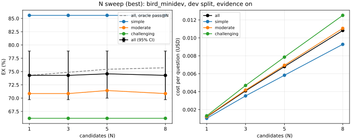

# Results

Generated by `text2sql.evals.report.regenerate_results_md` from the report directories under `reports/`; do not edit by hand. The headline is the `best` preset (23 runs). Each run link names the run's start time and the git SHA of the code that produced it.

Intervals are 95% percentile bootstrap over questions (10,000 resamples, seed 0). Deltas are paired on the same questions, with exact McNemar p-values. With a few hundred questions, two configurations a couple of points apart are usually not distinguishable: read a delta whose interval contains 0 as no measured difference. Partial runs are labelled in the Run column. Method: `docs/adr/009-evaluation-methodology.md`.

Runs on the held-out test split, any preset (the protocol allows one per row, after the last dev round): bird_arcwise, test split, evidence off: 1; bird_arcwise, test split, evidence on: 1; bird_minidev, test split, evidence off: 1; bird_minidev, test split, evidence on: 1; saas, test split, evidence n/a: 1.

## Headline (`best`)

| Dataset | Evidence | Split | Questions | EX (95% CI) | pass@N | Selection | Cost / question | Latency p50 / p95 | Run |
|---|---|---|---|---|---|---|---|---|---|
| BIRD Mini-Dev (original) | with | test | 150 | 68.0% (60.7-75.3) | 68.0% (N=1) | 100.0% | $0.0014 | 3.5 s / 7.9 s | [20261016-211125-70b12ce](reports/20261016-211125-70b12ce/summary.md) |
| BIRD Mini-Dev (original) | without | test | 150 | 60.0% (52.0-68.0) | 60.0% (N=1) | 100.0% | $0.0012 | 3.9 s / 7.7 s | [20261016-211438-70b12ce](reports/20261016-211438-70b12ce/summary.md) |
| Arcwise-Plat-SQL | with | test | 149 | 85.2% (79.2-90.6) | 85.2% (N=1) | 100.0% | $0.0013 | 3.4 s / 7.4 s | [20261016-211800-70b12ce](reports/20261016-211800-70b12ce/summary.md) |
| Arcwise-Plat-SQL | without | test | 149 | 75.2% (67.8-81.9) | 75.2% (N=1) | 100.0% | $0.0012 | 3.8 s / 7.6 s | [20261016-211921-70b12ce](reports/20261016-211921-70b12ce/summary.md) |
| SaaS (synthetic, multi-tenant) | n/a | test | 90 | 81.1% (72.2-88.9) | 81.1% (N=1) | 100.0% | $0.0013 | 3.2 s / 6.9 s | [20261016-212043-70b12ce](reports/20261016-212043-70b12ce/summary.md) |

SaaS safety: 15 adversarial questions; queries stopped per layer: grammar 0, validator 0, executor 0, scoping 0; reached the database: 0.

SaaS abstention: precision 84.6% (61.5-100.0), recall 91.7% (75.0-100.0).

## Effect of BIRD evidence

| Dataset | Split | Paired questions | EX without | EX with | Delta (95% CI) | McNemar p |
|---|---|---|---|---|---|---|
| BIRD Mini-Dev (original) | test | 150 | 60.0% | 68.0% | +8.0 pts (+2.0, +14.7) | 0.023 |
| Arcwise-Plat-SQL | test | 149 | 75.2% | 85.2% | +10.1 pts (+2.7, +17.4) | 0.011 |

## Ablations (`best`: bird_minidev, dev split, evidence on)

Each row changes one thing from the reference: a component switched off or one setting.

| Configuration | Questions | EX (95% CI) | Delta EX (paired 95% CI) | McNemar p | pass@N | Cost / question | Run |
|---|---|---|---|---|---|---|---|
| all components (reference) | 350 | 74.3% (69.7-78.9) | - | - | 74.3% | $0.0012 | [20261016-193953-c2450ae](reports/20261016-193953-c2450ae/summary.md) |
| bird_conventions off | 350 | 66.0% (61.1-70.9) | -8.3 pts (-11.4, -5.4) | <0.001 | 66.0% | $0.0013 | [20261016-200529-41a88a8](reports/20261016-200529-41a88a8/summary.md) |
| cheap_path on, n_candidates=5, question_analysis on, schema_linking on, strateg… | 350 | 73.4% (68.9-78.0) | -0.9 pts (-3.1, +1.1) | 0.607 | 76.0% | $0.0052 | [20261017-021621-6633bbb](reports/20261017-021621-6633bbb/summary.md) |
| grammar off, literal_check off, repair off | 350 | 74.3% (69.7-78.9) | +0.0 pts (-1.7, +1.7) | 1.000 | 74.3% | $0.0015 | [20261016-201156-41a88a8](reports/20261016-201156-41a88a8/summary.md) |
| judge_threshold=1.0, n_candidates=5, selector=judge | 350 | 73.7% (69.1-78.3) | -0.6 pts (-2.0, +0.9) | 0.688 | 75.4% | $0.0071 | [20261016-201915-41a88a8](reports/20261016-201915-41a88a8/summary.md) |
| judge_threshold=1.0, n_candidates=5, selector=unit_test | 350 | 74.0% (69.4-78.6) | -0.3 pts (-1.7, +0.9) | 1.000 | 75.4% | $0.0070 | [20261016-202341-41a88a8](reports/20261016-202341-41a88a8/summary.md) |
| literal_check off, repair off | 350 | 74.3% (69.7-78.9) | +0.0 pts (+0.0, +0.0) | 1.000 | 74.3% | $0.0012 | [20261016-200928-41a88a8](reports/20261016-200928-41a88a8/summary.md) |
| n_candidates=5, question_analysis on, schema_linking on, strategies=divide_conq… | 350 | 73.4% (68.9-78.0) | -0.9 pts (-3.1, +1.1) | 0.607 | 76.0% | $0.0081 | [20261017-020916-6633bbb](reports/20261017-020916-6633bbb/summary.md) |
| question_analysis on, value_retrieval on | 350 | 71.7% (66.9-76.3) | -2.6 pts (-4.6, -0.9) | 0.012 | 71.7% | $0.0012 | [20261016-201415-41a88a8](reports/20261016-201415-41a88a8/summary.md) |

## N sweep (`best`: bird_minidev, dev split, evidence on)

| N | Questions | EX (95% CI) | EX simple | EX moderate | EX challenging | pass@N | Cost / question | Run |
|---|---|---|---|---|---|---|---|---|
| 1 | 350 | 74.3% (69.7-78.9) | 85.6% | 70.9% | 66.2% | 74.3% | $0.0012 | [20261016-193953-c2450ae](reports/20261016-193953-c2450ae/summary.md) |
| 3 | 350 | 74.3% (69.7-78.9) | 85.6% | 70.9% | 66.2% | 74.9% | $0.0041 | [20261016-194713-41a88a8](reports/20261016-194713-41a88a8/summary.md) |
| 5 | 350 | 74.6% (70.0-78.9) | 85.6% | 71.4% | 66.2% | 75.4% | $0.0068 | [20261016-195049-41a88a8](reports/20261016-195049-41a88a8/summary.md) |
| 8 | 350 | 74.3% (69.7-78.9) | 85.6% | 70.9% | 66.2% | 75.7% | $0.0108 | [20261016-194211-41a88a8](reports/20261016-194211-41a88a8/summary.md) |

## Reasoning-effort sweep (`best`: bird_minidev, dev split, evidence on)

| Effort | Questions | EX (95% CI) | pass@N | Cost / question | Latency p50 / p95 | Run |
|---|---|---|---|---|---|---|
| low | 350 | 73.7% (69.1-78.3) | 73.7% | $0.0012 | 3.0 s / 5.0 s | [20261016-205741-41a88a8](reports/20261016-205741-41a88a8/summary.md) |
| medium | 350 | 74.3% (69.7-78.9) | 74.3% | $0.0012 | 3.0 s / 9.1 s | [20261016-193953-c2450ae](reports/20261016-193953-c2450ae/summary.md) |
| high | 350 | 74.6% (70.0-78.9) | 74.6% | $0.0018 | 4.7 s / 10.2 s | [20261016-210103-41a88a8](reports/20261016-210103-41a88a8/summary.md) |

## The `fast` preset

| Dataset | Evidence | Split | Questions | EX (95% CI) | pass@N | Selection | Cost / question | Latency p50 / p95 | Run |
|---|---|---|---|---|---|---|---|---|---|
| BIRD Mini-Dev (original) | with | dev | 350 | 73.7% (69.1-78.3) | 73.7% (N=1) | 100.0% | $0.0012 | 3.0 s / 5.0 s | [20261016-210605-41a88a8](reports/20261016-210605-41a88a8/summary.md) |

## The `baseline` preset

| Dataset | Evidence | Split | Questions | EX (95% CI) | pass@N | Selection | Cost / question | Latency p50 / p95 | Run |
|---|---|---|---|---|---|---|---|---|---|
| BIRD Mini-Dev (original) | with | dev | 350 | 74.3% (69.7-78.9) | 74.3% (N=1) | 100.0% | $0.0012 | 3.0 s / 9.1 s | [20261016-210820-41a88a8](reports/20261016-210820-41a88a8/summary.md) |
