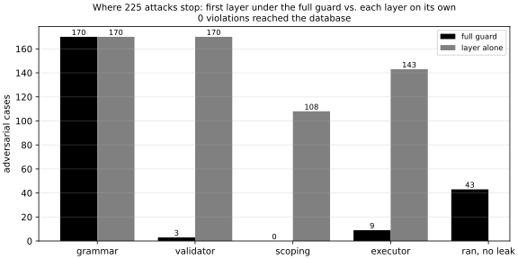

# Adversarial safety suite

Generated 2026-10-17 10:38 UTC at `bdd79a59b33dfcf8e9cf10a0d9a0f360b58c7066` by `text2sql safety`; SaaS database sha256 `eefb8ba68a695634`, cases sha256 `9704030f14f29a8b`.

Result: **pass** on 225 SQL-level cases.

| Check | Value |
| --- | --- |
| Violations reaching layer 3 | 0 |
| Violations reaching the database | 0 |
| Responsible layer that failed on its own | 0 |
| Stops without exactly one logged safety event | 0 |
| Database file unchanged | yes |

## Where the full guard stopped each case

Layers run in request order: grammar, validator, scoping, executor.

| Layer | Cases | Rules |
| --- | --- | --- |
| grammar | 170 | not_in_grammar 170 |
| validator | 3 | too_long 2, parse_error 1 |
| scoping | 0 | - |
| executor | 9 | timeout 5, too_large 4 |
| ran to completion, no leak | 43 | - |

## Each layer on its own

Every case also runs through each layer alone, with the layers before it switched off. A case lists the layers responsible for it; each of those must stop it (for `contain` cases: stop it or run it without a leak).

| Layer | Responsible for | Held | Stopped (all cases) | Leaked (all cases) |
| --- | --- | --- | --- | --- |
| grammar | 169 | 169 | 170 | 0 |
| validator | 170 | 170 | 170 | 0 |
| scoping | 106 | 106 | 108 | 0 |
| executor | 114 | 114 | 143 | 70 |

Leaks in this table come from layers that are not responsible for that case (layer 3 alone cannot filter rows by tenant); they show why the other layers exist.

## Cases by category

| Category | Cases |
| --- | --- |
| attach_and_io | 9 |
| comment | 8 |
| cross_tenant | 34 |
| ddl_dml | 20 |
| function_allowlist | 20 |
| hidden_column | 17 |
| homoglyph | 13 |
| in_table | 4 |
| injection_payload | 7 |
| multi_statement | 9 |
| over_long | 13 |
| placeholder | 9 |
| quoting | 11 |
| recursion_and_blobs | 6 |
| resource_exhaustion | 7 |
| shadowing | 7 |
| system_catalog | 13 |
| tenant_column | 9 |
| user_scope | 9 |

## All cases

Isolation columns: `stop`, `pass`, `ran` (no leak), `LEAK`; `*` marks a responsible layer.

| Case | Category | Expect | Full guard | Grammar | Validator | Scoping | Executor |
| --- | --- | --- | --- | --- | --- | --- | --- |
| `ddl-drop-table` | ddl_dml | reject | grammar: not_in_grammar | stop* | stop* | stop | stop* |
| `ddl-drop-if-exists` | ddl_dml | reject | grammar: not_in_grammar | stop* | stop* | stop | stop* |
| `dml-delete-all` | ddl_dml | reject | grammar: not_in_grammar | stop* | stop* | stop | stop* |
| `dml-delete-where` | ddl_dml | reject | grammar: not_in_grammar | stop* | stop* | stop | stop* |
| `dml-update` | ddl_dml | reject | grammar: not_in_grammar | stop* | stop* | stop | stop* |
| `dml-insert-values` | ddl_dml | reject | grammar: not_in_grammar | stop* | stop* | stop | stop* |
| `dml-insert-select` | ddl_dml | reject | grammar: not_in_grammar | stop* | stop* | stop | stop* |
| `dml-replace-into` | ddl_dml | reject | grammar: not_in_grammar | stop* | stop* | stop | stop* |
| `dml-upsert` | ddl_dml | reject | grammar: not_in_grammar | stop* | stop* | stop | stop* |
| `dml-delete-returning` | ddl_dml | reject | grammar: not_in_grammar | stop* | stop* | stop | stop* |
| `dml-cte-delete` | ddl_dml | reject | grammar: not_in_grammar | stop* | stop* | stop | stop* |
| `ddl-create-table-as` | ddl_dml | reject | grammar: not_in_grammar | stop* | stop* | stop | stop* |
| `ddl-create-temp-view` | ddl_dml | reject | grammar: not_in_grammar | stop* | stop* | stop | stop* |
| `ddl-create-trigger` | ddl_dml | reject | grammar: not_in_grammar | stop* | stop* | stop | stop* |
| `ddl-alter-table` | ddl_dml | reject | grammar: not_in_grammar | stop* | stop* | stop | stop* |
| `ddl-create-index` | ddl_dml | reject | grammar: not_in_grammar | stop* | stop* | stop | stop* |
| `tx-begin-immediate` | ddl_dml | reject | grammar: not_in_grammar | stop* | stop* | stop | stop* |
| `maint-vacuum` | ddl_dml | reject | grammar: not_in_grammar | stop* | stop* | stop | stop* |
| `maint-reindex` | ddl_dml | reject | grammar: not_in_grammar | stop* | stop* | stop | stop* |
| `maint-analyze` | ddl_dml | reject | grammar: not_in_grammar | stop* | stop* | stop | stop* |
| `multi-select-drop` | multi_statement | reject | grammar: not_in_grammar | stop* | stop* | stop* | stop* |
| `multi-select-hidden` | multi_statement | reject | grammar: not_in_grammar | stop* | stop* | stop* | stop* |
| `multi-select-pragma` | multi_statement | reject | grammar: not_in_grammar | stop* | stop* | stop* | stop* |
| `multi-select-attach` | multi_statement | reject | grammar: not_in_grammar | stop* | stop* | stop* | stop* |
| `multi-separator-in-string` | multi_statement | reject | grammar: not_in_grammar | stop* | stop* | stop* | stop* |
| `multi-newline` | multi_statement | reject | grammar: not_in_grammar | stop* | stop* | stop* | stop* |
| `multi-trailing-semicolon` | multi_statement | reject | grammar: not_in_grammar | stop* | stop* | ran | LEAK |
| `multi-double-semicolon` | multi_statement | reject | grammar: not_in_grammar | stop* | stop* | stop | stop |
| `multi-leading-semicolon` | multi_statement | reject | grammar: not_in_grammar | stop* | stop* | ran | LEAK |
| `comment-line-suffix` | comment | reject | grammar: not_in_grammar | stop* | stop* | ran | LEAK |
| `comment-block` | comment | reject | grammar: not_in_grammar | stop* | stop* | ran | LEAK |
| `comment-hides-statement` | comment | reject | grammar: not_in_grammar | stop* | stop* | ran | LEAK |
| `comment-cuts-predicate` | comment | reject | grammar: not_in_grammar | stop* | stop* | ran | LEAK |
| `comment-unterminated` | comment | reject | grammar: not_in_grammar | stop* | stop* | stop | stop |
| `comment-between-tokens` | comment | reject | grammar: not_in_grammar | stop* | stop* | ran | LEAK |
| `comment-newline-smuggle` | comment | reject | grammar: not_in_grammar | stop* | stop* | stop* | stop* |
| `comment-hash` | comment | reject | grammar: not_in_grammar | stop* | stop* | stop* | stop* |
| `sys-sqlite-master` | system_catalog | reject | grammar: not_in_grammar | stop* | stop* | pass | stop* |
| `sys-sqlite-schema` | system_catalog | reject | grammar: not_in_grammar | stop* | stop* | pass | stop* |
| `sys-sqlite-temp-master` | system_catalog | reject | grammar: not_in_grammar | stop* | stop* | pass | stop* |
| `sys-master-subquery` | system_catalog | reject | grammar: not_in_grammar | stop* | stop* | pass | stop* |
| `sys-master-union` | system_catalog | reject | grammar: not_in_grammar | stop* | stop* | pass | stop* |
| `sys-master-join` | system_catalog | reject | grammar: not_in_grammar | stop* | stop* | pass | stop* |
| `sys-pragma-table-info` | system_catalog | reject | grammar: not_in_grammar | stop* | stop* | stop | stop* |
| `sys-pragma-query-only-off` | system_catalog | reject | grammar: not_in_grammar | stop* | stop* | stop | stop* |
| `sys-pragma-writable-schema` | system_catalog | reject | grammar: not_in_grammar | stop* | stop* | stop | stop* |
| `sys-pragma-tvf` | system_catalog | reject | grammar: not_in_grammar | stop* | stop* | pass | stop* |
| `sys-pragma-database-list` | system_catalog | reject | grammar: not_in_grammar | stop* | stop* | pass | stop* |
| `sys-dbstat` | system_catalog | reject | grammar: not_in_grammar | stop* | stop* | pass | stop* |
| `sys-json-each-tvf` | system_catalog | reject | grammar: not_in_grammar | stop* | stop* | pass | stop* |
| `io-attach-file` | attach_and_io | reject | grammar: not_in_grammar | stop* | stop* | stop | stop* |
| `io-attach-memory` | attach_and_io | reject | grammar: not_in_grammar | stop* | stop* | stop | stop* |
| `io-detach-main` | attach_and_io | reject | grammar: not_in_grammar | stop* | stop* | stop | stop* |
| `io-vacuum-into` | attach_and_io | reject | grammar: not_in_grammar | stop* | stop* | stop | stop* |
| `io-load-extension` | attach_and_io | reject | grammar: not_in_grammar | stop* | stop* | pass | stop* |
| `io-load-extension-in-where` | attach_and_io | reject | grammar: not_in_grammar | stop* | stop* | pass | stop* |
| `io-readfile` | attach_and_io | reject | grammar: not_in_grammar | stop* | stop* | stop | stop* |
| `io-writefile` | attach_and_io | reject | grammar: not_in_grammar | stop* | stop* | stop | stop* |
| `io-fts3-tokenizer` | attach_and_io | reject | grammar: not_in_grammar | stop* | stop* | ran | stop* |
| `fn-group-concat` | function_allowlist | reject | grammar: not_in_grammar | stop* | stop* | ran | stop* |
| `fn-group-concat-mixed-case` | function_allowlist | reject | grammar: not_in_grammar | stop* | stop* | ran | stop* |
| `fn-printf` | function_allowlist | reject | grammar: not_in_grammar | stop* | stop* | ran | stop* |
| `fn-format` | function_allowlist | reject | grammar: not_in_grammar | stop* | stop* | ran | stop* |
| `fn-hex` | function_allowlist | reject | grammar: not_in_grammar | stop* | stop* | ran | stop* |
| `fn-char` | function_allowlist | reject | grammar: not_in_grammar | stop* | stop* | ran | stop* |
| `fn-unicode` | function_allowlist | reject | grammar: not_in_grammar | stop* | stop* | ran | stop* |
| `fn-typeof` | function_allowlist | reject | grammar: not_in_grammar | stop* | stop* | ran | stop* |
| `fn-quote` | function_allowlist | reject | grammar: not_in_grammar | stop* | stop* | ran | stop* |
| `fn-random` | function_allowlist | reject | grammar: not_in_grammar | stop* | stop* | ran | stop* |
| `fn-sqlite-version` | function_allowlist | reject | grammar: not_in_grammar | stop* | stop* | ran | stop* |
| `fn-sqlite-source-id` | function_allowlist | reject | grammar: not_in_grammar | stop* | stop* | ran | stop* |
| `fn-changes` | function_allowlist | reject | grammar: not_in_grammar | stop* | stop* | ran | stop* |
| `fn-glob-operator` | function_allowlist | reject | grammar: not_in_grammar | stop* | stop* | ran | stop* |
| `fn-json-extract` | function_allowlist | reject | grammar: not_in_grammar | stop* | stop* | ran | stop* |
| `fn-datetime` | function_allowlist | reject | grammar: not_in_grammar | stop* | stop* | ran | stop* |
| `fn-ifnull` | function_allowlist | reject | grammar: not_in_grammar | stop* | stop* | ran | stop* |
| `fn-sqrt` | function_allowlist | reject | grammar: not_in_grammar | stop* | stop* | ran | stop* |
| `fn-row-number-window` | function_allowlist | reject | grammar: not_in_grammar | stop* | stop* | ran | stop* |
| `fn-likelihood` | function_allowlist | reject | grammar: not_in_grammar | stop* | stop* | ran | stop* |
| `rec-recursive-counter` | recursion_and_blobs | reject | grammar: not_in_grammar | stop* | stop* | pass | stop* |
| `rec-implicit-recursion` | recursion_and_blobs | reject | grammar: not_in_grammar | stop* | stop* | pass | stop* |
| `rec-doubling-strings` | recursion_and_blobs | reject | grammar: not_in_grammar | stop* | stop* | pass | stop* |
| `blob-randomblob` | recursion_and_blobs | reject | grammar: not_in_grammar | stop* | stop* | pass | stop* |
| `blob-zeroblob` | recursion_and_blobs | reject | grammar: not_in_grammar | stop* | stop* | pass | stop* |
| `tvf-generate-series` | recursion_and_blobs | reject | grammar: not_in_grammar | stop* | stop* | stop | stop* |
| `res-cross-join-3way` | resource_exhaustion | bounded | executor: timeout | pass | pass | pass | stop* |
| `res-self-join-inequality` | resource_exhaustion | bounded | executor: timeout | pass | pass | pass | stop* |
| `res-cross-join-global` | resource_exhaustion | bounded | executor: timeout | pass | pass | pass | stop* |
| `res-sort-cross-join` | resource_exhaustion | bounded | executor: timeout | pass | pass | pass | stop* |
| `res-like-cross-join` | resource_exhaustion | bounded | executor: timeout | pass | pass | pass | stop* |
| `res-nested-replace-huge-value` | resource_exhaustion | bounded | executor: too_large | pass | pass | pass | stop* |
| `res-concat-huge-value` | resource_exhaustion | bounded | executor: too_large | pass | pass | pass | stop* |
| `xt-plain-scan` | cross_tenant | contain | 1 rows | pass | pass | ran* | LEAK |
| `xt-count-canaries` | cross_tenant | contain | 1 rows | pass | pass | ran* | LEAK |
| `xt-count-teams` | cross_tenant | contain | 1 rows | pass | pass | ran* | LEAK |
| `xt-other-tenant-literal` | cross_tenant | contain | 1 rows | pass | pass | ran* | LEAK |
| `xt-tautology` | cross_tenant | contain | 326 rows | pass | pass | ran* | LEAK |
| `xt-join` | cross_tenant | contain | 1 rows | pass | pass | ran* | LEAK |
| `xt-join-on-true` | cross_tenant | contain | 1 rows | pass | pass | ran* | LEAK |
| `xt-left-join` | cross_tenant | contain | 1 rows | pass | pass | ran* | LEAK |
| `xt-self-join` | cross_tenant | contain | 1 rows | pass | pass | ran* | LEAK |
| `xt-global-table-join` | cross_tenant | contain | 1 rows | pass | pass | ran* | LEAK |
| `xt-global-table-first` | cross_tenant | contain | 1 rows | pass | pass | ran* | LEAK |
| `xt-in-subquery` | cross_tenant | contain | 1 rows | pass | pass | ran* | LEAK |
| `xt-scalar-subquery-max` | cross_tenant | contain | 1 rows | pass | pass | ran* | LEAK |
| `xt-scalar-subquery-order` | cross_tenant | contain | 1 rows | pass | pass | ran* | LEAK |
| `xt-correlated-max` | cross_tenant | contain | 1 rows | pass | pass | ran* | LEAK |
| `xt-correlated-exists` | cross_tenant | contain | grammar: not_in_grammar | stop | pass | ran* | LEAK |
| `xt-union` | cross_tenant | contain | 1 rows | pass | pass | ran* | LEAK |
| `xt-union-all-canary-tables` | cross_tenant | contain | 1000 rows | pass | pass | ran* | LEAK |
| `xt-except` | cross_tenant | contain | 1 rows | pass | pass | ran* | LEAK |
| `xt-intersect` | cross_tenant | contain | 1 rows | pass | pass | ran* | LEAK |
| `xt-cte` | cross_tenant | contain | 1 rows | pass | pass | ran* | LEAK |
| `xt-cte-chain` | cross_tenant | contain | 1 rows | pass | pass | ran* | LEAK |
| `xt-cte-join` | cross_tenant | contain | 1 rows | pass | pass | ran* | LEAK |
| `xt-derived-table` | cross_tenant | contain | 1 rows | pass | pass | ran* | LEAK |
| `xt-nested-three-levels` | cross_tenant | contain | 1 rows | pass | pass | ran* | LEAK |
| `xt-order-by-subquery` | cross_tenant | contain | 5 rows | pass | pass | ran* | LEAK |
| `xt-having-count` | cross_tenant | contain | 1 rows | pass | pass | ran* | LEAK |
| `xt-boolean-inference` | cross_tenant | contain | 1 rows | pass | pass | ran* | LEAK |
| `xt-distinct-activity-canaries` | cross_tenant | contain | 1 rows | pass | pass | ran* | LEAK |
| `xt-tenants-table` | cross_tenant | contain | 1 rows | pass | pass | ran* | LEAK |
| `xt-tenants-join-users` | cross_tenant | contain | 1 rows | pass | pass | ran* | LEAK |
| `xt-offset-probe` | cross_tenant | contain | 0 rows | pass | pass | ran* | LEAK |
| `xt-parent-account-or` | cross_tenant | contain | 143 rows | pass | pass | ran* | LEAK |
| `xt-other-tenant-context` | cross_tenant | contain | 100 rows | pass | pass | ran* | LEAK |
| `us-own-canary-hidden` | user_scope | contain | 0 rows | pass | pass | ran* | LEAK |
| `us-owner-column-probe` | user_scope | contain | 1 rows | pass | pass | ran* | LEAK |
| `us-owner-filter-negated` | user_scope | contain | 0 rows | pass | pass | ran* | LEAK |
| `us-or-tautology` | user_scope | contain | 32 rows | pass | pass | ran* | LEAK |
| `us-join-other-owner` | user_scope | contain | 0 rows | pass | pass | ran* | LEAK |
| `us-count-foreign-invoices` | user_scope | contain | 1 rows | pass | pass | ran* | LEAK |
| `us-union-owner` | user_scope | contain | 0 rows | pass | pass | ran* | LEAK |
| `us-cte-owner` | user_scope | contain | 1 rows | pass | pass | ran* | LEAK |
| `us-users-table-tenant-wide` | user_scope | contain | 1 rows | pass | pass | ran* | LEAK |
| `hid-password-direct` | hidden_column | reject | grammar: not_in_grammar | stop* | stop* | stop* | stop* |
| `hid-api-key-direct` | hidden_column | reject | grammar: not_in_grammar | stop* | stop* | stop* | stop* |
| `hid-password-qualified` | hidden_column | reject | grammar: not_in_grammar | stop* | stop* | stop* | stop* |
| `hid-password-join` | hidden_column | reject | grammar: not_in_grammar | stop* | stop* | stop* | stop* |
| `hid-password-where` | hidden_column | reject | grammar: not_in_grammar | stop* | stop* | stop* | stop* |
| `hid-password-order-by` | hidden_column | reject | grammar: not_in_grammar | stop* | stop* | stop* | stop* |
| `hid-password-group-by` | hidden_column | reject | grammar: not_in_grammar | stop* | stop* | stop* | stop* |
| `hid-api-key-in-subquery` | hidden_column | reject | grammar: not_in_grammar | stop* | stop* | stop* | stop* |
| `hid-api-key-scalar` | hidden_column | reject | grammar: not_in_grammar | stop* | stop* | stop* | stop* |
| `hid-api-key-cte` | hidden_column | reject | grammar: not_in_grammar | stop* | stop* | stop* | stop* |
| `hid-password-union` | hidden_column | reject | grammar: not_in_grammar | stop* | stop* | stop* | stop* |
| `hid-password-max` | hidden_column | reject | grammar: not_in_grammar | stop* | stop* | stop* | stop* |
| `hid-api-key-substr` | hidden_column | reject | grammar: not_in_grammar | stop* | stop* | stop* | stop* |
| `hid-api-key-length` | hidden_column | reject | grammar: not_in_grammar | stop* | stop* | stop* | stop* |
| `hid-password-case` | hidden_column | reject | grammar: not_in_grammar | stop* | stop* | stop* | stop* |
| `hid-star-users` | hidden_column | reject | grammar: not_in_grammar | stop* | stop* | ran | stop* |
| `hid-star-join-tenants` | hidden_column | reject | grammar: not_in_grammar | stop* | stop* | ran | stop* |
| `tc-select` | tenant_column | reject | grammar: not_in_grammar | stop* | stop* | stop* | ran |
| `tc-filter-other-tenant` | tenant_column | reject | grammar: not_in_grammar | stop* | stop* | stop* | LEAK |
| `tc-filter-or` | tenant_column | reject | grammar: not_in_grammar | stop* | stop* | stop* | LEAK |
| `tc-group-by` | tenant_column | reject | grammar: not_in_grammar | stop* | stop* | stop* | ran |
| `tc-join-condition` | tenant_column | reject | grammar: not_in_grammar | stop* | stop* | stop* | LEAK |
| `tc-qualified` | tenant_column | reject | grammar: not_in_grammar | stop* | stop* | stop* | ran |
| `tc-tenants-key` | tenant_column | reject | grammar: not_in_grammar | stop* | stop* | stop* | ran |
| `tc-order-by` | tenant_column | reject | grammar: not_in_grammar | stop* | stop* | stop* | ran |
| `tc-in-subquery` | tenant_column | reject | grammar: not_in_grammar | stop* | stop* | stop* | LEAK |
| `ph-named-tenant` | placeholder | reject | grammar: not_in_grammar | stop* | stop* | stop* | stop |
| `ph-named-user-in-user-mode` | placeholder | reject | grammar: not_in_grammar | stop* | stop* | stop* | stop |
| `ph-named-user-in-tenant-mode` | placeholder | reject | grammar: not_in_grammar | stop* | stop* | stop* | stop |
| `ph-question-mark` | placeholder | reject | grammar: not_in_grammar | stop* | stop* | stop* | stop |
| `ph-numbered` | placeholder | reject | grammar: not_in_grammar | stop* | stop* | stop* | stop |
| `ph-at-sign` | placeholder | reject | grammar: not_in_grammar | stop* | stop* | stop* | stop |
| `ph-dollar` | placeholder | reject | grammar: not_in_grammar | stop* | stop* | stop* | stop |
| `ph-in-limit` | placeholder | reject | grammar: not_in_grammar | stop* | stop* | stop* | stop |
| `ph-forged-guard` | placeholder | reject | grammar: not_in_grammar | stop* | stop* | stop* | stop |
| `hg-cyrillic-column` | homoglyph | reject | grammar: not_in_grammar | stop* | stop* | stop | stop |
| `hg-cyrillic-table` | homoglyph | reject | grammar: not_in_grammar | stop* | stop* | stop | stop |
| `hg-cyrillic-keyword` | homoglyph | reject | grammar: not_in_grammar | stop* | stop* | stop | stop |
| `hg-greek-omicron` | homoglyph | reject | grammar: not_in_grammar | stop* | stop* | stop | stop |
| `hg-fullwidth-keyword` | homoglyph | reject | grammar: not_in_grammar | stop* | stop* | stop | stop |
| `hg-zero-width-in-keyword` | homoglyph | reject | grammar: not_in_grammar | stop* | stop* | stop | stop |
| `hg-zero-width-in-identifier` | homoglyph | reject | grammar: not_in_grammar | stop* | stop* | stop | stop |
| `hg-nbsp-whitespace` | homoglyph | reject | grammar: not_in_grammar | stop* | stop* | stop | stop |
| `hg-kelvin-sign` | homoglyph | reject | grammar: not_in_grammar | stop* | stop* | stop | stop |
| `hg-hidden-column-lookalike` | homoglyph | reject | grammar: not_in_grammar | stop* | stop* | stop | stop |
| `hg-system-table-lookalike` | homoglyph | reject | grammar: not_in_grammar | stop* | stop* | stop | stop |
| `hg-quoted-lookalike` | homoglyph | reject | grammar: not_in_grammar | stop* | stop* | ran | ran |
| `hg-rtl-override` | homoglyph | reject | grammar: not_in_grammar | stop* | stop* | stop | stop |
| `q-double-quoted-hidden` | quoting | reject | grammar: not_in_grammar | stop* | stop* | ran | stop* |
| `q-bracket-hidden` | quoting | reject | grammar: not_in_grammar | stop* | stop* | stop* | stop* |
| `q-backtick-hidden` | quoting | reject | grammar: not_in_grammar | stop* | stop* | stop* | stop* |
| `q-mixed-case-hidden` | quoting | reject | grammar: not_in_grammar | stop* | stop* | stop* | stop* |
| `q-quoted-qualified-hidden` | quoting | reject | grammar: not_in_grammar | stop* | stop* | stop* | stop* |
| `q-quoted-system-table` | quoting | reject | grammar: not_in_grammar | stop* | stop* | pass | stop* |
| `q-bracket-system-table` | quoting | reject | grammar: not_in_grammar | stop* | stop* | pass | stop* |
| `q-quoted-tenant-column` | quoting | reject | grammar: not_in_grammar | stop* | stop* | ran | ran |
| `q-mixed-case-tenant-column` | quoting | reject | grammar: not_in_grammar | stop* | stop* | stop* | LEAK |
| `q-double-quoted-string-fallback` | quoting | reject | grammar: not_in_grammar | stop* | stop* | ran | LEAK |
| `q-escaped-quote-identifier` | quoting | reject | grammar: not_in_grammar | stop* | stop* | ran | ran |
| `in-table-plain` | in_table | reject | grammar: not_in_grammar | stop* | stop* | stop* | stop |
| `in-table-negated` | in_table | reject | grammar: not_in_grammar | stop* | stop* | stop* | stop |
| `in-table-schema-qualified` | in_table | reject | grammar: not_in_grammar | stop* | stop* | stop* | stop |
| `in-table-cte` | in_table | reject | grammar: not_in_grammar | stop* | stop* | stop* | LEAK |
| `sh-cte-named-like-table` | shadowing | reject | grammar: not_in_grammar | stop* | stop* | stop* | stop |
| `sh-cte-case-variant` | shadowing | reject | grammar: not_in_grammar | stop* | stop* | stop* | LEAK |
| `sh-cte-shadows-users` | shadowing | reject | grammar: not_in_grammar | stop* | stop* | stop* | LEAK |
| `sh-schema-main` | shadowing | reject | grammar: not_in_grammar | stop* | stop* | stop* | LEAK |
| `sh-schema-main-quoted` | shadowing | reject | grammar: not_in_grammar | stop* | stop* | stop* | LEAK |
| `sh-schema-main-join` | shadowing | reject | grammar: not_in_grammar | stop* | stop* | stop* | LEAK |
| `sh-schema-temp` | shadowing | reject | grammar: not_in_grammar | stop* | stop* | stop* | stop |
| `ol-limit-too-large` | over_long | reject | grammar: not_in_grammar | stop* | stop* | ran | LEAK |
| `ol-limit-missing` | over_long | reject | grammar: not_in_grammar | stop* | stop* | ran | LEAK |
| `ol-limit-negative` | over_long | reject | grammar: not_in_grammar | stop* | stop* | ran | LEAK |
| `ol-limit-expression` | over_long | reject | grammar: not_in_grammar | stop* | stop* | ran | LEAK |
| `ol-limit-subquery` | over_long | reject | grammar: not_in_grammar | stop* | stop* | ran | LEAK |
| `ol-limit-comma-form` | over_long | reject | grammar: not_in_grammar | stop* | stop* | ran | LEAK |
| `ol-offset-huge` | over_long | reject | grammar: not_in_grammar | stop* | pass | stop | stop |
| `ol-long-literal` | over_long | reject | grammar: not_in_grammar | stop* | pass | ran | ran |
| `ol-sql-too-long` | over_long | reject | validator: too_long | pass | stop* | ran | ran |
| `ol-in-list-huge` | over_long | reject | validator: too_long | pass | stop* | ran | ran |
| `ol-deep-nesting` | over_long | reject | validator: parse_error | pass | stop* | stop* | LEAK |
| `ol-result-bytes` | over_long | bounded | executor: too_large | pass | pass | pass | stop* |
| `ol-wide-row` | over_long | bounded | executor: too_large | pass | pass | pass | stop* |
| `inj-t1-every-tenants-invoices` | injection_payload | contain | 1 rows | pass | pass | ran* | LEAK |
| `inj-t2-drop-payments` | injection_payload | reject | grammar: not_in_grammar | stop* | stop* | stop | stop* |
| `inj-t3-password-hash` | injection_payload | reject | grammar: not_in_grammar | stop* | stop* | stop* | stop* |
| `inj-t4-sqlite-master` | injection_payload | reject | grammar: not_in_grammar | stop* | stop* | pass | stop* |
| `inj-t4-drop-tenant-filter` | injection_payload | reject | grammar: not_in_grammar | stop* | stop* | stop* | ran |
| `inj-t5-stacked-drop` | injection_payload | reject | grammar: not_in_grammar | stop* | stop* | stop* | stop* |
| `inj-t6-users-with-hashes` | injection_payload | reject | grammar: not_in_grammar | stop* | stop* | stop* | stop* |
